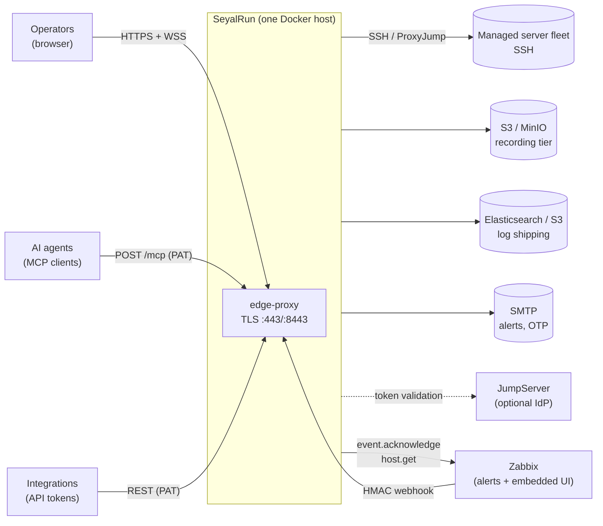
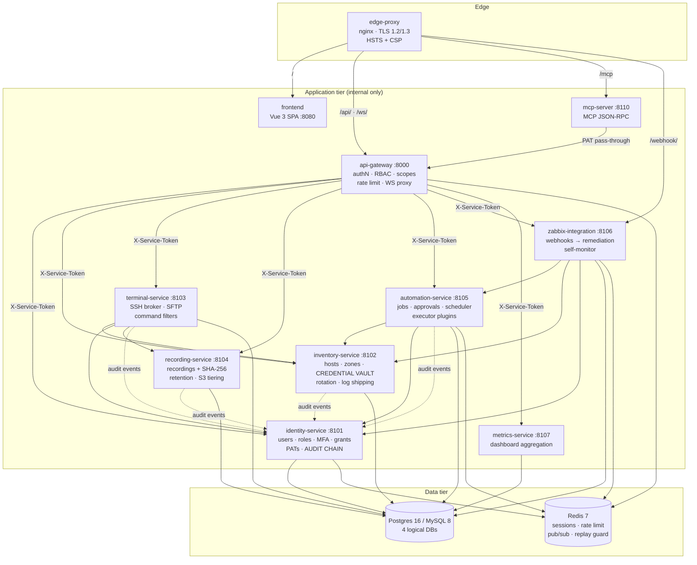
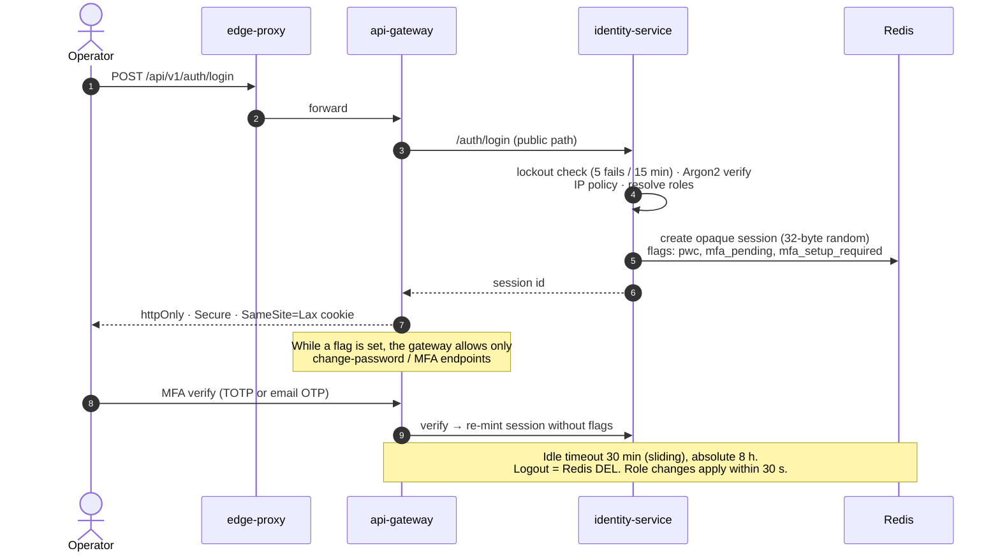
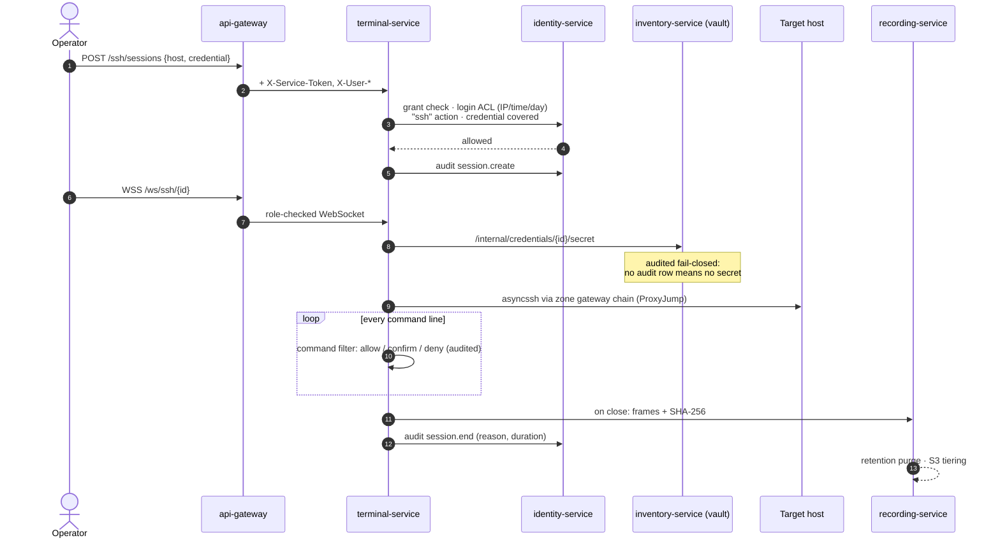
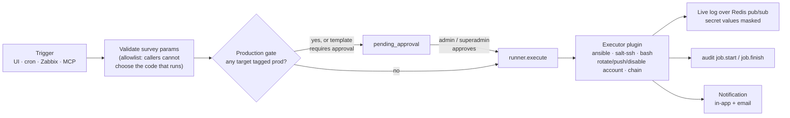
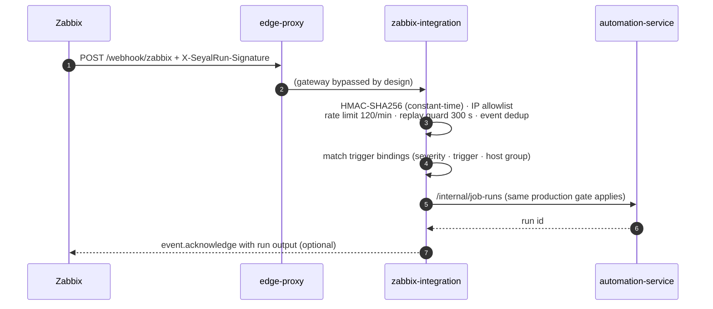
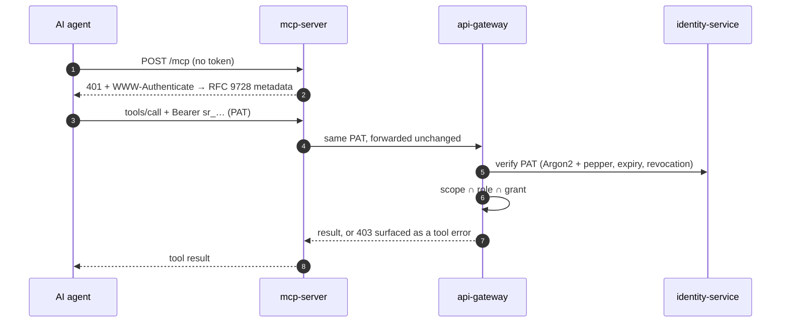
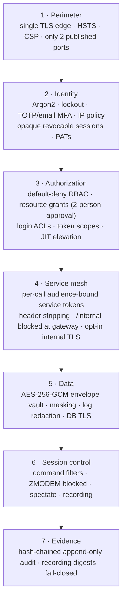
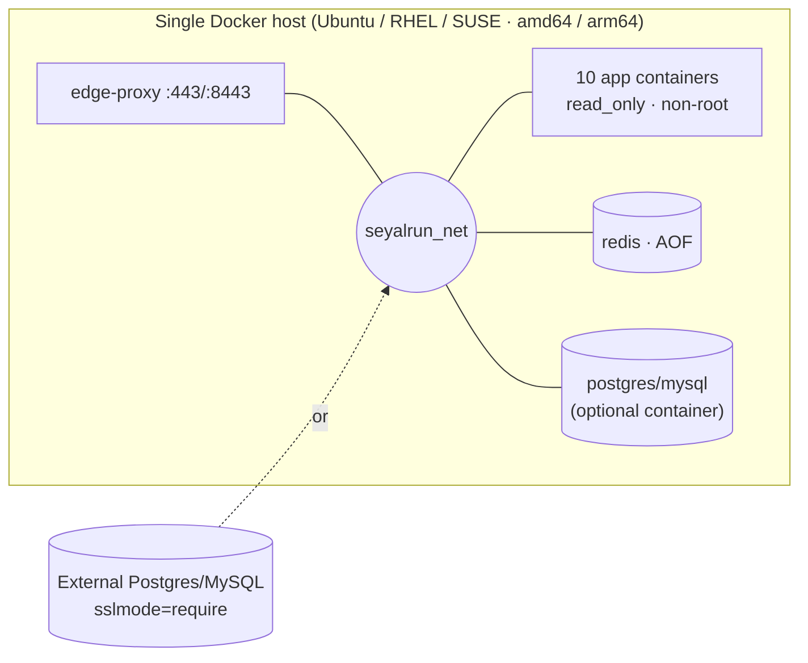
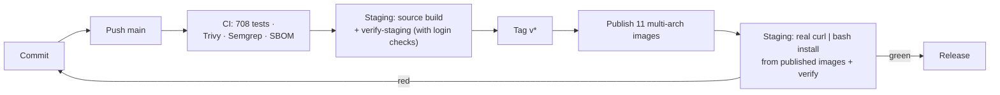

# SeyalRun v2.0.1: Architecture, Design and Security

**Audience:** CTO and engineering leadership · **Release:** v2.0.1 (2026-11-02) · **Scope:** the `core/` platform

SeyalRun is a self-hosted **Privileged Access Management (PAM) and automation platform** for a server fleet. Operators get brokered, recorded SSH access to hosts. Credentials are vaulted, and nobody needs to see them to use them. Automation (Ansible, salt-ssh, scripts) runs with approval gates. Zabbix alerts can trigger remediation runs. AI agents can use all of this through MCP, under the same permission and audit boundary as a human operator.

---

## 1. Executive summary

| | |
|---|---|
| **What it is** | 11 Python and nginx services behind one TLS edge, on one Docker Compose host |
| **Who uses it** | Operators (web UI), Zabbix (webhooks, embedded UI), AI agents (MCP), other systems (API tokens) |
| **Core promise** | Every privileged action is **authorized** (role ∩ grant ∩ token scope), **brokered** (no one holds raw secrets) and **evidenced** (tamper-evident audit chain plus session recordings) |
| **Deploys as** | One command, `curl … install.sh \| bash`. Multi-arch images (amd64 and arm64) on Docker Hub, an air-gapped install path, Postgres or MySQL |
| **Compliance stance** | Mapped to **PCI DSS** and **SOC 2**. A risk register ships with the code, and every claim cites the file that implements it |
| **Maturity** | Single-node by design today. Most controls are implemented, and the gaps are documented (§9) |

---

## 2. Architecture view

### 2.1 System context

### 2.2 Container view

Only **edge-proxy** publishes ports to the host. Everything else sits on one internal bridge network (`seyalrun_net`).

### 2.3 Edge routing

| Path | Upstream | Notes |
|---|---|---|
| `:8080/*` | 301 to HTTPS | `/health` is the only plain-HTTP path |
| `/` | frontend | SPA with `index.html` fallback |
| `/api/` | api-gateway | 1 GB body limit (file transfer) |
| `/ws/` | api-gateway | WebSocket upgrade, 1 h timeout (terminal, job logs, notifications) |
| `/mcp`, `/.well-known/oauth-protected-resource` | mcp-server | **443 only.** The advertised URL carries no port |
| `/webhook/` | zabbix-integration | **Bypasses the gateway** and is authenticated by HMAC instead (§6.5) |

---

## 3. Components

| Service | Responsibility | Owns (data) | Depends on |
|---|---|---|---|
| **edge-proxy** | TLS termination, routing, security headers | none | none |
| **frontend** | Vue 3 + Vite SPA (Pinia, xterm.js) | none | gateway |
| **api-gateway** | Single API entry point: session/PAT authentication, RBAC, PAT scopes, MFA and password-change gates, rate limiting, WebSocket proxy, header sanitisation | none (Redis sessions) | all backends |
| **identity-service** | Users, roles, groups, MFA, SSO/IdP, access grants (with approval), login ACLs, command filters, PATs, access reviews, **the audit hash chain** | `seyalrun_identity` (21 tables) | inventory, terminal, automation |
| **inventory-service** | Hosts, host groups, zones and jump gateways, **credential vault** (envelope encryption), rotation policies, log-backend config and shipping | `seyalrun_inventory` | identity, automation, Zabbix API |
| **terminal-service** | SSH broker (asyncssh, multi-hop ProxyJump), SFTP, live command filtering, session spectating | `seyalrun_terminal` | identity, inventory, recording |
| **recording-service** | Session recordings with SHA-256 integrity, retention purge, S3 tiering | `seyalrun_terminal` (shared) | identity, terminal, inventory |
| **automation-service** | Projects, job templates, runs, approvals, cron scheduler, notifications, housekeeping, **executor plugins** | `seyalrun_automation` | identity, inventory, Redis |
| **zabbix-integration-service** | Zabbix webhook intake, mapping trigger bindings to job runs, posting results back to Zabbix, agentless self-monitoring endpoint | `seyalrun_automation` (shared) | automation, inventory, identity, Zabbix API |
| **metrics-service** | Read-only dashboard aggregation across all four DBs | none (read-only) | identity |
| **mcp-server** | Exposes SeyalRun as MCP tools and resources for AI agents; authorizes nothing itself | none | gateway |

**Shared libraries** (`core/libs`): `servicetoken` (service JWTs), `rbaccore` (role model), `apiscopes` (PAT scopes), `audithash` (hash chain), `dbcore` (engine and crypto), `securelog` (redaction and log backends), `secrets` (fail-fast), `elevation`, `obsmetrics`, and `pluginbase` (extension points).

**Optional modules** (not loaded at runtime by the core stack):
- `modules/zabbix`: a PHP frontend module that embeds SeyalRun inside the Zabbix UI, using HMAC-signed SSO.
- `modules/jumpserver-legacy`: quarantined; Phase 2 porting material.

---

## 4. Design principles and key decisions

| # | Decision | Why it matters |
|---|---|---|
| 1 | **One door in.** Only edge-proxy is exposed, and every API call goes through api-gateway. | One place to enforce authN, authZ, rate limits and header hygiene. Backends refuse calls that lack a gateway-minted service token. |
| 2 | **Zero-trust between services.** Every internal call carries an `X-Service-Token`: HS256, 60 s TTL, audience-bound to the target service. | A compromised container cannot call a peer it was not addressed to. Replay windows are seconds long. |
| 3 | **Brokered, never handed over.** Terminal and automation unwrap credentials using their own service identity, so users and tokens never receive the secret. | Least privilege. Revealing a secret is a separate, MFA-gated, audited action. |
| 4 | **Three-way intersection for every action:** `role ∩ resource grant ∩ token scope` | An API token can only ever do a subset of what the person who issued it can do. |
| 5 | **Evidence is a first-class product feature.** A SHA-256 hash-chained audit log, append-only at the DB layer, plus recording digests. | The audit trail is admissible, not just present. Tampering is detectable. |
| 6 | **Fail closed on security paths.** Missing secret: the service won't start. Audit write fails: the secret is withheld. Production gate errors: approval is required. | Control failures do not silently degrade into open access. |
| 7 | **Plugins on stable axes** (`pluginbase`): IdentityProvider, CredentialKind, KeyProvider, CommandFilterMatcher, ActionExecutor, TriggerSource, SessionBroker. | New integrations without touching core. Unused integrations are never imported. |
| 8 | **Agents are users with less power.** MCP forwards the agent's PAT to the gateway, so there is one security path and one audit trail. Interactive shell is deliberately *not* an agent tool. | AI adoption without a parallel, weaker control plane. |
| 9 | **Agentless self-monitoring.** Zabbix polls one aggregate endpoint; there is no sidecar and no Docker-socket exposure. | Observability without widening the attack surface. |
| 10 | **Database per bounded context.** Four logical DBs on one server, one Alembic history per service. | Clear ownership; services can be split out later. |

---

## 5. Key flows

### 5.1 Login (with forced password change and MFA)

Sessions are **opaque server-side tokens, not JWTs**, so they can be revoked instantly. Alternative identity providers are Zabbix SSO (HMAC handshake, one-time code with a 120 s TTL) and JumpServer (validated against its API). LDAP, OIDC and SAML are **not implemented**.

### 5.2 Privileged SSH session and recording

### 5.3 Automation run with approval gates

- **Concurrency guard:** a template that is already running returns `409`. A run is never queued against host state that has moved on.
- **Production gate fails closed:** if inventory cannot be reached, approval is required.

### 5.4 Zabbix alert to auto-remediation

### 5.5 AI agent over MCP

**Tools available:**
- Reads: hosts, zones, templates, runs, audit, metrics, sessions, notifications, `whoami`
- Pre-approved actions: `run_automation`, `create_host`, `ack_notification`

`credentials:*` and `admin:*` scopes are never grantable to tokens.

---

## 6. Security architecture

### 6.1 Defence in depth

### 6.2 Identity and authentication

| Control | Implementation |
|---|---|
| Password storage | Argon2 (argon2-cffi) |
| Brute force | DB-backed lockout per username\|IP (5 fails, 15 min lock). A login-spike alert fires at ≥3 usernames from one IP. Gateway rate limit is 600 req/min per IP+user |
| MFA | TOTP (secret AES-encrypted at rest) or email OTP (5 min TTL, 5 attempts). Can be enforced per group |
| Step-up | MFA re-proof required to **reveal a credential** (30 s single-use reveal token) and for **JIT elevation** (admins only, 30 min default) |
| Sessions | 32-byte opaque ID in Redis. 30 min idle / 8 h absolute. Instant revocation. Optional single session per user |
| API tokens (PAT) | `sr_` + 32 random bytes. Only Argon2(token + pepper) is stored. Expiry and revocation supported |
| First login | Seed admin is forced to change password before any other call works |

### 6.3 Authorization model

- **Roles** are superadmin, admin, support and user, plus custom roles stored as permission documents. Checks are **default-deny** per path segment and HTTP method.
- **Resource grants** map user/group to host/host group, credential and actions (`ssh`, `sftp`, `upload`, `download`), with start and expiry dates. A grant is **inactive until a different admin approves it**. Email approval links are single-use and hashed.
- **SSH connect** has to pass five checks in order: kiosk binding → grant → login ACL (IP, time, weekday) → `ssh` action → credential covered.
- **SFTP** enforces the `sftp`/`download`/`upload` actions per grant, with path containment.
- **Command filters** are regex rules evaluated on every typed command line, with actions deny, confirm (a 30 s timeout counts as deny) or default-deny. Every decision is audited.

### 6.4 Secrets and cryptography

| Item | Implementation |
|---|---|
| Vault | **Envelope encryption.** Each credential has its own DEK under AES-256-GCM (12-byte nonce). DEKs are wrapped by a KEK via the `KeyProvider` plugin |
| KEK | scrypt(N=2¹⁴, r=8, p=1) over `ZA_VAULT_PASSWORD` + `ZA_VAULT_SALT`. **Environment-derived today; the KMS/HSM slot exists but has no implementation yet** |
| Key rotation | `ops/rotate_vault_key.py`: rewraps DEKs, re-encrypts legacy rows, has a DRY_RUN mode |
| API exposure | The API returns only `has_secret`, never the value. Credential history keeps 2 prior secrets, encrypted |
| Job output | Per-run secret values are replaced with `***REDACTED***` in logs |
| Structured logs | Fields named `password`, `secret`, `token`, `vault`, `api_key` etc. are redacted in every service |
| Startup | **Every secret is required, with no defaults.** A service refuses to start without one |

### 6.5 Transport and network

- **External:** TLS 1.2/1.3 (`HIGH:!aNULL:!MD5`); HTTP redirects to HTTPS.
  - Headers: HSTS for 1 year with subdomains, `nosniff`, Referrer-Policy, COOP.
  - CSP: `script-src 'self'`; `frame-ancestors` is limited to `'self'` plus the configured Zabbix origin.
  - CORS: a single configured origin.
- **Internal:** zero-trust service tokens on every hop. **Internal TLS is an opt-in overlay** (`docker-compose.internal-tls.yml`): an internal CA (RSA-4096), with edge-proxy verifying its upstreams.
- **Database:** `sslmode=require` by default.
- **Webhooks:** HMAC-SHA256 checked in constant time, plus an optional IP allowlist, 120/min/IP rate limit, Redis replay guard (300 s) and event dedup.
- **Exposure:** only edge-proxy publishes ports. The DB and Redis containers publish nothing.

### 6.6 Audit and evidence

- **Tamper-evident chain:** each row stores `seq`, `prev_hash` and `entry_hash` (SHA-256), so editing, deleting or reordering rows is detected. Verification: `GET /audit/verify`, and the UI checks the chain on load.
- **Single writer:** identity-service owns the chain, and writes are serialized with an advisory lock (Postgres) or `GET_LOCK` (MySQL).
- **Append-only at the DB:** triggers reject UPDATE and DELETE (migration `022`).
- **What is audited:**
  - authentication: logins, failures, IP denials, MFA, SSO
  - elevation
  - token create and revoke
  - changes to grants, ACLs, roles and settings
  - credential issuance and reveal
  - command-filter decisions
  - session start and end, with duration
  - job start and finish
- **Recordings:** a SHA-256 over the canonical frames is taken at ingest and can be re-verified on demand.
- **Log shipping:** local JSONL, Elasticsearch, S3 or both. The backend is chosen at runtime and its config is stored vault-encrypted.

### 6.7 Supply chain and release integrity

- **CI on every push:** a security-invariant suite of **708 tests** covering:
  - service-token audience and expiry
  - fail-fast secrets
  - crypto and key hierarchy
  - audit-chain tamper detection and fail-closed audit
  - RBAC coverage and PAT scopes
  - shell-injection guards
  - SFTP containment
  - MCP behaviour
- **Security scan:** on push, PR and weekly. Trivy (dependencies, misconfiguration, secrets) **blocks on fixable HIGH/CRITICAL**. Project Semgrep rules block, while the upstream packs are advisory. A CycloneDX SBOM is produced per run.
- **Releases:** only `v*` tags publish images. `:latest` moves on stable tags only. Installs pin `SEYALRUN_VERSION`.
- **Containers:** non-root (uid 10001), `read_only` root filesystem plus tmpfs, `nginx-unprivileged` for the edge.

### 6.8 Compliance mapping

The repo ships `docs/compliance/` with the code:
- `control-mapping.md`: PCI DSS / SOC 2 controls mapped to the code that implements them
- `risk-register.md`: open and closed risks
- `staging-validation.md`: controls exercised against a live stack

Closed risks: R-1 (internal encryption), R-2/R-3 (session and job audit), R-5 (DB-layer immutability), R-6 (KEK rotation), R-10 (audit result indication).

---

## 7. Deployment and operations

### 7.1 Topology

- **Compose layering:** `docker-compose.prod.yml` (published images) + `docker-compose.db.yml` (dockerized DB profile) + optional `docker-compose.internal-tls.yml`. That gives **13 containers** with the dockerized DB.
- **Install** (`install.sh`, 8 steps):
  1. prerequisites from distro packages, not `get.docker.com`
  2. install directory
  3. deploy files
  4. `.env` with random secrets
  5. TLS cert
  6. DB mode and ports
  7. image pull, or `docker load` from an air-gapped archive
  8. migrations, admin seed and stack start
- **Lifecycle:** a generated `seyalrunctl start|stop|restart|status|logs|update`.
- **Databases:** Postgres 16 or MySQL 8, dockerized or external. Four logical DBs, and seven Alembic histories (one per service).
- **Observability:**
  - every service exposes `/health` and JSON `/metrics`;
  - a Zabbix 7.0/8.0 template polls one aggregate endpoint, with discovery for every service;
  - logs are JSON lines;
  - housekeeping jobs cover retention, tiering, log replay and weak-credential scans.

### 7.2 Release pipeline

Step `S2` was added for v2.0.1. Installing from the published images is what exposed the install-path bugs fixed in this release.

---

## 8. Scalability profile

SeyalRun is **single-node by design** today:

| Component | Constraint |
|---|---|
| automation-service | The cron scheduler and housekeeping run in-process with no leader election, so **more than one replica would run jobs twice** |
| identity-service | Zabbix SSO one-time codes are held in memory (single-replica assumption) |
| zabbix-integration | Webhook dispatch is fire-and-forget; in-flight work is lost on restart |
| Metrics | In-process counters (single uvicorn worker) |
| Recordings | Frames are stored as JSON in the terminal DB, which is the main growth driver. S3 tiering offloads them after 7 days |
| Redis | A single instance holds sessions, rate limits and replay guards |
| Resources | No CPU or memory limits are set in compose |

The path to HA is clear: leader election for the scheduler, SSO codes and job dispatch moved to Redis, a Redis replica or sentinel, and the stateless services (gateway, edge, frontend, mcp) replicated behind a load balancer.

---

## 9. Risk posture and roadmap

### 9.1 Open risks (risk register)

| ID | Severity | Risk | Status |
|---|---|---|---|
| R-9 | High | Audit rows written before 2026-08-09 can never be verified | Fixed going forward; old environments need a re-baseline |
| R-12 | Medium | salt-ssh writes credential passwords to a temporary roster file during a run | Accepted 2026-09-20 |
| R-4 | Medium | Recording playback and presigned URLs are not audited | Partial: integrity is protected, access is not audited |
| R-7 | Medium | Audit forwarding from satellite services is best-effort, so a dropped event is undetectable | Open |
| R-8 | Low | No chain lock for engines other than Postgres/MySQL | Open; latent until a third engine is added |

### 9.2 Additional findings from this architecture review

Each finding below was **verified in the code** for this review. They are not yet in the risk register.

| # | Finding | Impact | Recommendation |
|---|---|---|---|
| F-1 | **Legacy `read`/`write` PAT scopes bypass per-domain scoping**, and the default for a new token is `["read"]` (`libs/apiscopes`, `identity schemas.py`) | A default token can read any segment the issuer's role allows, including credential metadata, users and audit. Secrets themselves still need MFA reveal | Default to an empty scope list and stop issuing legacy scopes; migrate existing tokens |
| F-2 | **No separation of duties on job approval.** The requester can approve their own run, and approve/reject writes no audit row | A single admin can push a change to production alone, untraced | Block self-approval as grant approval already does; audit `job.approve`/`job.reject` |
| F-3 | **SSH host keys are not verified in automation.** Ansible and salt-ssh use `StrictHostKeyChecking=no`; asyncssh is strict only if `SSH_KNOWN_HOSTS_PATH` is set | Possible man-in-the-middle on the management network, which could capture credentials | Ship a managed known_hosts per zone and make it strict by default |
| F-4 | **Redis has no authentication** | Any container on the network could read or forge sessions and elevation flags | `requirepass`/ACL, plus TLS when not co-located |
| F-5 | **Internal TLS is off by default** | Plaintext on the bridge network (service tokens limit the damage) | Make the internal-TLS overlay the default in `install.sh` |
| F-6 | **Audit chain and recording digests are unkeyed SHA-256** | A DB superuser who disables the trigger can rewrite history and recompute the hashes | HMAC with a key outside the DB, or periodic external anchoring |
| F-7 | **The webhook replay guard keys on the signature only** (no timestamp), and the Zabbix SSO handshake has no replay check | A captured request can be replayed after 300 s; a leaked module secret lets an attacker mint superadmin SSO | Signed timestamp plus a nonce, and a short validity window |
| F-8 | **The gateway rate limiter fails open** when Redis is down | Brute-force protection disappears during a Redis outage (DB lockout still applies) | Fail closed for `auth/*` routes |
| F-9 | **Containers lack `cap_drop: [ALL]` and `no-new-privileges`** | Weaker container breakout posture | Add both to every service |
| F-10 | **CI:** built images are not scanned or signed, actions are pinned by tag rather than SHA, and the upstream Semgrep packs are advisory | Supply-chain integrity gap | Trivy image scan, cosign signing, SLSA provenance, SHA-pinned actions |
| F-11 | **Backup covers only 2 of the 4 DBs** (identity, inventory), and there is no restore script | Terminal/recording and automation data is not backed up | Back up all four DBs plus Redis; add a tested restore runbook |
| F-12 | **The MCP `ack_notification` tool calls `/notifications/{id}/ack`**, but the service exposes `/{id}/read` | The tool fails at runtime | Align the route and add a contract test |

**Documentation drift to correct:**
- `control-mapping.md` still lists KEK rotation as a gap (closed as R-6).
- It says there is no logout endpoint (there is one, but it is not audited).
- It cites zxcvbn for login passwords (zxcvbn applies to stored credentials only; login passwords need 8 characters).
- It cites 151 tests (there are now 708).
- R-11 (sftp/upload/download not enforced) is **stale**: terminal-service now enforces these grants (`api/sftp.py`).

### 9.3 Suggested roadmap

| Horizon | Theme | Items |
|---|---|---|
| **Now (next patch)** | Close the verified gaps | F-1, F-2, F-4, F-12, F-9; refresh the compliance docs |
| **Next quarter** | Harden by default | F-3 managed known_hosts; F-5 internal TLS on by default; F-7 replay windows; F-11 full backup and restore; F-10 signed images |
| **Following** | Enterprise readiness | KMS/HSM `KeyProvider` (AWS KMS / Vault Transit); OIDC/SAML/LDAP IdPs; keyed audit anchoring (F-6); HA (scheduler leader election, Redis HA, replicated stateless tier) |

---

## Appendix A: Ports and data stores

| Component | Port | Exposure | Store |
|---|---|---|---|
| edge-proxy | 8080 → 443/8443 | **Host** | none |
| api-gateway | 8000 | internal | Redis |
| identity / inventory / terminal / recording | 8101 / 8102 / 8103 / 8104 | internal | identity / inventory / terminal / terminal DB |
| automation / zabbix-integration / metrics | 8105 / 8106 / 8107 | internal | automation / automation / all (read-only) |
| mcp-server | 8110 | internal (via edge `/mcp`, 443) | none |
| frontend | 8080 | internal | none |
| Redis 7 | 6379 | internal | AOF volume |
| Postgres 16 / MySQL 8 | 5432 / 3306 | internal or external | `seyalrun_identity`, `_inventory`, `_terminal`, `_automation` |

## Appendix B: Where to look in the code

| Topic | Path |
|---|---|
| Gateway routing and auth | `core/services/api-gateway/app/{proxy,security,main}.py` |
| Edge routing and headers | `core/services/edge-proxy/templates/default.conf.template` |
| Role model / PAT scopes | `core/libs/rbaccore`, `core/libs/apiscopes` |
| Service tokens | `core/libs/servicetoken` |
| Vault | `core/libs/dbcore/crypto.py`, `core/services/inventory-service/app/vault.py` |
| Audit chain | `core/libs/audithash`, `core/services/identity-service/app/audit.py` |
| SSH broker / filters | `core/services/terminal-service/app/ws/terminal.py` |
| Executors | `core/services/automation-service/app/plugins/executors/` |
| Webhooks | `core/services/zabbix-integration-service/app/api/webhook.py` |
| MCP | `core/services/mcp-server/` |
| Compliance | `docs/compliance/` |
| Install / CI | `install.sh`, `.github/workflows/` |
